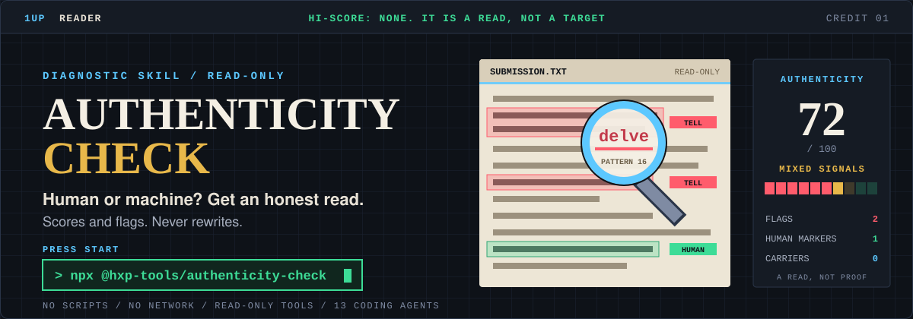
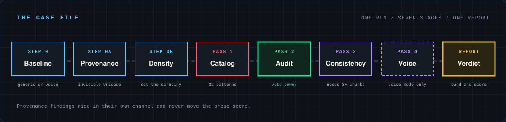
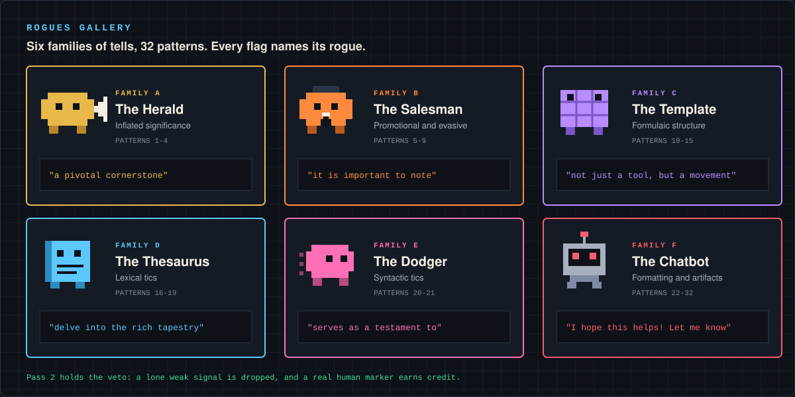
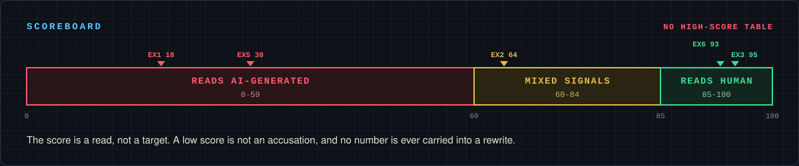
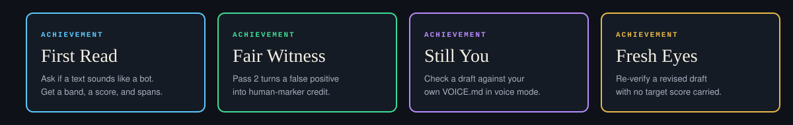

# authenticity-check



[](https://www.npmjs.com/package/@hxp-tools/authenticity-check)


[](https://github.com/hannsxpeter/authenticity-check/actions/workflows/drift.yml)

**Human or machine? Get an honest read.**

Paste any text and ask whether it sounds like a bot. You get a band, a 0-100
score, the exact spans that read as AI-generated or templated, the spans that
read as a person, and a separate scan for hidden Unicode carriers. The skill
is plain markdown with read-only tools. It scores and flags. It never
rewrites.

Part of [`@hxp-tools`](https://www.npmjs.com/org/hxp-tools). The read-only
half of a pair with [humanizer](https://github.com/hannsxpeter/humanizer).

---

## Press start

```bash
npx @hxp-tools/authenticity-check@latest
```

That installs the skill for every supported tool it finds (Claude Code,
Codex, Cursor, Windsurf). Name tools to pick them (`claude codex`), use `all`
for every one, and `--uninstall` to remove exactly what it installed. The
installer needs Node 18 or newer; the skill itself runs no code.

Then restart your agent and ask:

```text
does this sound like a bot? <paste text>
```

You do not need to say "authenticity check." Oblique cues work too: "this
feels generated," "rate the AI-ness," "does this still sound like me," or
"is there invisible Unicode in this."

For other tools, clone this repo and keep its adapter file beside `SKILL.md`
and `references/` (see [Supported tools](#supported-tools)).

---

## The case file



| Stage | What happens |
|---|---|
| Step 0: Baseline | Generic mode, or voice mode when a sample, named author, or `VOICE.md` exists |
| Step 0a: Provenance | Read-only scan for invisible and format Unicode, with a context audit |
| Step 0b: Density | Sets scrutiny low, medium, or high so human-first text is not over-flagged |
| Pass 1: Catalog | Scans against 32 patterns in six families |
| Pass 2: Audit | Mandatory false-positive audit with veto power |
| Pass 3: Consistency | Read-only stylometric and drift checks across three or more chunks |
| Pass 4: Voice | Deviation from the target voice, in voice mode only |
| Report | Band, score, provenance, flags, human markers, basis, caveats, next step |

---

## Rogues gallery



Every flag names its family and pattern from
`references/tell-patterns.md`, so you can see why a span was caught. The
guard on the other side is `references/do-not-flag.md`: a lone weak signal is
dropped, and a real human marker (a specific number, a mixed feeling, an odd
rhythm) turns into credit.

---

## Scoreboard



```text
### Authenticity report
Mode: generic
Scrutiny: high (from the density pre-check)

Authenticity: Reads AI-generated   Score: 18/100

### Flagged spans
- "stands as a pivotal cornerstone" -> Family A, significance inflation
- "delve into the rich tapestry," "leveraging robust" -> Family D, AI-vocabulary clustering
- Whole-passage: uniform sentence length, the core machine fingerprint

### Reads as human (deliberately not flagged)
- Nothing qualifies. No specific detail, number, or mixed feeling to credit.
```

That is an excerpt of Example 1. `references/examples.md` holds six worked
diagnostic runs, including careful human prose that must not be scored low
and laundered AI prose (clean vocabulary, uniform rhythm) that must not be
scored high.

There is no high-score table. The score is a read, not a target, and a low
score is not an accusation against anyone.

---

## Achievements



| Achievement | Earned by |
|---|---|
| First Read | Asking whether any text sounds like a bot and getting the full report |
| Fair Witness | Seeing Pass 2 veto a false positive and credit a human marker instead |
| Still You | Running voice mode against your own `VOICE.md` or a pasted sample |
| Fresh Eyes | Re-verifying a revised draft with a fresh read and no target score |

---

## Diagnose, then decide

```
authenticity-check  ->  you read the flags and decide  ->  humanizer
   (diagnose)               (judgment, not automation)       (rewrite)
        ^                                                        |
        |________________ re-verify, fresh read _________________|
```

A tool that scores text and then rewrites it to raise its own score is a
detector-gaming loop. Keeping diagnosis and rewriting in two skills, with a
person in between, is what stops that loop from forming. So this skill never
rewrites, never removes marks, and never hands a target score to a rewrite.

[voiceprint](https://github.com/hannsxpeter/voiceprint) bundles both skills
into one fixed, single-pass run. The criteria descend from
[Scriveno](https://github.com/hannsxpeter/scriveno), whose core promise is
that drafted prose should sound like the writer, not like AI.

## Text provenance

Step 0a classifies inspectable carriers in supplied text (zero-width and
format controls, bidi controls, tag characters, variation selectors, unusual
spaces) and audits each one in context, so normal multilingual orthography
is not mislabeled. Findings go in their own report section and never move the
prose score. It does not inspect files, metadata, images, audio, or video, and
it does not detect statistical token watermarks. Full limits are in
`references/provenance-signals.md`.

The carrier taxonomy and context guardrails were adapted, as prompt
instructions only, from the MIT-licensed
[watermarks-remover](https://github.com/guillaumemeyer/watermarks-remover)
v0.4.0 at commit `28eca2d91fd4`. No upstream code is included, and no
removal or normalization is performed.

## Supported tools

| Tool | File it reads | Install |
|---|---|---|
| Claude Code | `SKILL.md` | `npx @hxp-tools/authenticity-check claude`, or use the repo in-project |
| Cursor | `.cursor/rules/authenticity-check.mdc` | `npx @hxp-tools/authenticity-check cursor`, or copy the rule + `SKILL.md` + `references/` |
| Codex | `AGENTS.md` | `npx @hxp-tools/authenticity-check codex`, or keep `AGENTS.md` in the project |
| Antigravity | `AGENTS.md` | Keep `AGENTS.md` + `SKILL.md` + `references/` in the workspace |
| Gemini CLI | `GEMINI.md` | Keep `GEMINI.md` + `SKILL.md` + `references/` in the project |
| Pi | `AGENTS.md` | Point Pi at this repo or its `AGENTS.md` |
| OpenCode | `AGENTS.md` or `SKILL.md` | Copy the skill into OpenCode's skills directory, or keep `AGENTS.md` in the project |
| GitHub Copilot | `.github/copilot-instructions.md` | Copy it + `SKILL.md` + `references/` into the target repository |
| Windsurf | `.windsurfrules` | `npx @hxp-tools/authenticity-check windsurf`, or keep `.windsurfrules` in the project |
| Cline | `.clinerules` | Keep `.clinerules` + `SKILL.md` + `references/` in the workspace |
| Continue | `.continue/rules/authenticity-check.md` | Keep the rule + `SKILL.md` + `references/` in the project |
| Zed | `AGENTS.md` or `.continue/rules/authenticity-check.md` | Zed reads `AGENTS.md`, already present |
| Aider | `CONVENTIONS.md` | `aider --read CONVENTIONS.md`; keep `SKILL.md` + `references/` in the repo |

Every adapter points at the same `SKILL.md` and `references/`, so the method
is identical across tools. All names are `authenticity-check`, so it installs
side by side with humanizer without collision.

## Vendored criteria

`references/tell-patterns.md`, `references/do-not-flag.md`, and
`references/voice-matching.md` are synced copies of humanizer's criteria, so
the two skills agree on what a tell is. Last synced 2026-10-07 from humanizer
commit `09bf76d`. Do not edit them here: fix them upstream in humanizer, then
re-vendor. Each file's header stamp is the contract.
`references/scoring.md`, `references/examples.md`, and
`references/provenance-signals.md` are native to this repo.

## Verification

`evals/evals.json` holds nine verification cases: AI-heavy text, voice
deviation, restraint, a detector-evasion refusal, an oblique trigger, a
diagnose-then-"just fix it" boundary, a relocated signature, a suspicious
Unicode carrier, and a legitimate script joiner. `evals/RESULTS.md` records
the blind runs. Neither is part of the runtime skill.

A drift check runs on every pull request and every push to `main`. It fails
when versions, counts, evals, adapters, vendored stamps, file references, this
README's layout, the installer, or house style drift apart. Run `npm test`
(or `python3 .github/scripts/check_drift.py`) before you open a pull request.

## Scope

This skill gives an honest read of how authentically text reads as a person's
work. It is not built or tuned to defeat plagiarism checkers or AI-detection
systems, and it names no detector. Requests to get AI work past a graded or
contractual assessment are reframed toward that honest read.

## Layout

```
SKILL.md                          the skill: workflow, guardrails, output contract
references/tell-patterns.md       vendored from humanizer: 32-pattern catalog (Pass 1)
references/do-not-flag.md         vendored from humanizer: false positives, human markers (Pass 2)
references/voice-matching.md      vendored from humanizer: voice reading (Pass 4)
references/provenance-signals.md  native: Unicode carrier classes, context audit, limits (Step 0a)
references/scoring.md             native: bands, 0-100 rubric, consistency heuristics
references/examples.md            native: six worked diagnostic runs
AGENTS.md                         adapter: Codex, Antigravity, OpenCode, Pi, Zed
GEMINI.md                         adapter: Gemini CLI
.cursor/rules/authenticity-check.mdc  adapter: Cursor
.github/copilot-instructions.md   adapter: GitHub Copilot
.windsurfrules                    adapter: Windsurf
.clinerules                       adapter: Cline
.continue/rules/authenticity-check.md  adapter: Continue and Zed
CONVENTIONS.md                    adapter: Aider
bin/authenticity-check.js         npx installer (copies SKILL.md and references/)
package.json                      npm package @hxp-tools/authenticity-check
assets/hero.svg                   README art: title screen
assets/case-map.svg               README art: the stages of one run
assets/rogues.svg                 README art: the six families of tells
assets/scoreboard.svg             README art: the score bands
assets/achievements.svg           README art: achievement badges
evals/evals.json                  verification cases (not part of the runtime skill)
evals/files/VOICE.md              voice baseline used by the voice-deviation eval
evals/RESULTS.md                  recorded blind verification runs
CHANGELOG.md                      release history
.github/workflows/drift.yml       CI: drift check and installer smoke test
.github/workflows/publish.yml     CI: publishes a v* tag to npm
.github/scripts/check_drift.py    the drift check (repo tooling, not part of the skill)
```

## License

MIT. See [LICENSE](LICENSE).
